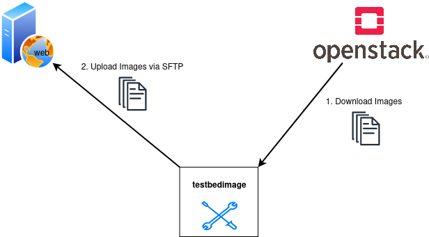

# Deploy Images

This command downloads the newest versions of all the images that starts with the image-name defined in the command `--images` from the Openstack. The images are not stored locally but redirected to a location provided by an SFTP-server. A Manifest.json is written after each image-transfer.



## Command-Line Options

```
usage: testbedimage deploy [-h] [-I IMAGES] [-s SSH_SERVER] [-P SSH_PORT] [-u SSH_USER] [-p SSH_PASS] [-k SSH_PASSPHRASE] [-t SSH_DIRECTORY] [-i SSH_KEYFILE] [-d]

options:
  -h, --help            show this help message and exit
  -I IMAGES, --images IMAGES
                        imagenames seperated by comma
  -s SSH_SERVER, --ssh-server SSH_SERVER
  -P SSH_PORT, --ssh-port SSH_PORT
  -u SSH_USER, --ssh-user SSH_USER
  -p SSH_PASS, --ssh-pass SSH_PASS
  -k SSH_PASSPHRASE, --ssh-passphrase SSH_PASSPHRASE
  -t SSH_DIRECTORY, --ssh-directory SSH_DIRECTORY
  -i SSH_KEYFILE, --ssh-keyfile SSH_KEYFILE
  -d, --debug
```

`-I IMAGES, --images IMAGES`
: A comma-seperated list of image-names to check.

  Default: `atb-videoserver-image,atb-adminpc-image,atb-attacker-image,atb-corpdns-image,atb-fw-inet-lan-dmz-image`

`-s SSH_SERVER, --ssh-server SSH_SERVER`
: Use this hostname or ip-address to connect via SFTP.

  Type: str

`-P SSH_PORT, --ssh-port SSH_PORT`
: Use this port to connect via SFTP.

  Type: int

  Default: `22`

`-u SSH_USER, --ssh-user SSH_USER`
: Use this username to login to the SFTP-server.

  Type: str

`-p SSH_PASS, --ssh-pass SSH_PASS`
: Use this password to login to the SFTP-server.

  Type: str

`-k SSH_PASSPHRASE, --ssh-passphrase SSH_PASSPHRASE`
: Keyphrase to unlock the keyfile

  Type: str

`-t SSH_DIRECTORY, --ssh-directory SSH_DIRECTORY`
: Change into this directory on the SFTP-server.

  Type: str

  Default: `""`

`-i SSH_KEYFILE, --ssh-keyfile SSH_KEYFILE`
: Keyfile to use to login to the SFTP-serfver.

  Type: str

`-d`
: Enables debug-output.

## Deploy to S3-compatible Object Storage

Supply `--s3-bucket` to select S3 instead of SFTP. For example, for an
OVHcloud S3-compatible bucket:

```sh
testbedimage deploy \
  --s3-bucket attackbed-test-images \
  --s3-endpoint https://s3.gra.io.cloud.ovh.net \
  --s3-region gra \
  --s3-prefix images
```

Use the endpoint and region for your actual bucket; the values above are an
example. Omit `--s3-endpoint` to use AWS S3. The bucket must already exist.

| Option | Meaning | Default |
| --- | --- | --- |
| `--s3-bucket` | Destination bucket; selects S3 deployment | None |
| `--s3-endpoint` | S3-compatible endpoint URL | Boto3 default |
| `--s3-region` | Bucket region | Boto3 default |
| `--s3-prefix` | Optional object key prefix | Empty |
| `--s3-profile` | AWS configuration/credentials profile | Boto3 default |

Authentication uses [boto3's normal credential resolution](https://boto3.amazonaws.com/v1/documentation/api/latest/guide/credentials.html),
including environment variables, shared AWS credentials/configuration files,
and roles. No secret CLI flags are needed. S3 destination options require a
nonempty bucket. Use either SSH or S3 destination options in a command;
`--s3-bucket` selects S3 and SSH options are ignored when it is supplied.
`--images` and `--debug` work for both destinations.

Images stream directly from OpenStack through boto3's managed multipart upload,
without storing image files locally. The existing image filenames, checksums,
metadata, manifest JSON schema, and local timestamp convention are preserved.
For example, a release contains:

```text
images/2026-10-14T10:30:00/atb-attacker-image.img
images/2026-10-14T10:30:00/atb-videoserver-image.img
images/2026-10-14T10:30:00/Manifest.json
```

Leading and trailing slashes in the optional prefix are stripped. S3 deployment
does not create a `current` object or duplicate images. Import commands and
their existing URLs are unchanged; private-bucket import and presigned URLs
are outside this deployment feature.

The manifest is uploaded after each successfully uploaded image. On failure,
completed objects and the last successfully uploaded manifest remain. The
manifest never includes a failed image. An image upload failure aborts its
unfinished multipart upload; failure to update the manifest leaves the newly
completed image object intact. S3 deployment exits with status 0 on success
and a nonzero status on failure. The existing SFTP command behavior is preserved.

The credentials need permission to upload objects and abort multipart uploads
in the destination prefix. Configure a bucket lifecycle rule to remove
incomplete multipart uploads after abrupt process termination or network loss
that prevents an abort. A deployment uses the existing second-resolution
timestamp convention; avoid simultaneous deployments into the same prefix.

## Development checks

Install the project and test tools in a virtual environment, then run:

```sh
python -m pip install -e . pytest flake8
python -m pytest -q
python -m flake8 src/testbedimage tests
```

The tests use stubbed S3 responses and require no live AWS/OVH credentials.
A live smoke test should use a test bucket and a small OpenStack image, then
check the timestamped image bytes and manifest before deploying large images.
