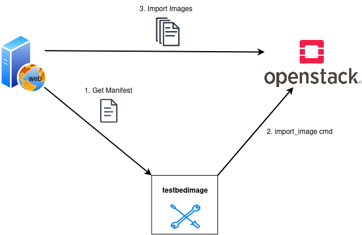

# Importing Images

The `import_images` subcommand fetches the manifest from the image-server. After that it extracts the image locations. Finally it starts a web-import for those images at the Openstack.

!!! note

    Even if the testbedimage-tool initiates the web-import, it is important to know that the Openstack will download the images directly from the image-server.



## Command-Line Options

```
usage: testbedimage import_images [-h] [-u URL] [-I IMAGES]
                                 [--s3-bucket S3_BUCKET]
                                 [--s3-endpoint S3_ENDPOINT]
                                 [--s3-region S3_REGION]
                                 [--s3-prefix S3_PREFIX]
                                 [--s3-profile S3_PROFILE] [-d]

options:
  -h, --help            show this help message and exit
  -u URL, --url URL     url to the images
  -I IMAGES, --images IMAGES
                        image names separated by comma
  -d, --debug
```

`-u URL, --url URL`
: The URI to the image-server.

  Default: `https://aecidimages.ait.ac.at/current`

`-d`
: Enables debug-output.

## Import directly from S3

Use `--s3-bucket` to read a private or public S3 release with boto3 and stream
each image directly into Glance. The CLI sends the image bytes; Glance does
not fetch an S3 URL. Existing URL imports continue using `web-download`.

```sh
testbedimage import_images \
  --s3-bucket attackbed \
  --s3-endpoint https://s3.eu-west-par.io.cloud.ovh.net \
  --s3-region eu-west-par \
  --s3-prefix 'test/2026-10-14T10:30:00' \
  --s3-profile attackbed-paris
```

Use your bucket's actual endpoint, region, and complete release prefix,
including its timestamp. Import does not create a timestamp or search for a
`current` pointer. It fetches `Manifest.json` and the named images from that
prefix using `GetObject`; bucket-listing permission is unnecessary.

The S3 options have the same meanings as for deployment. The bucket and release
prefix are required; endpoint, region, and credentials profile are optional.
Omit the endpoint for AWS S3. Credentials use boto3's normal resolution, so
no secret command-line flags are needed. Use S3 options for direct import or
`--url` for `web-download`; supplying a bucket selects S3 and ignores the URL.
No `--method` option is needed.

Image data streams without a local image file or whole-image memory buffer.
Object size, SHA-256, and MD5 (when present in the manifest) are checked.
Imported images use the manifest's disk/container formats, the filename
without `.img` as their name, and private visibility. Each import creates a
new image, even if that name already exists, and waits up to one hour for it
to become `active`. On failure, the new failed image is deleted; if cleanup
also fails, its image ID is logged for manual cleanup. Source objects and
previously completed images remain untouched. S3 imports return exit status
0 on success and nonzero on failure.

## Select images

Both S3 and URL imports accept `-I/--images` with comma-separated names:

```sh
testbedimage import_images --s3-bucket attackbed \
  --s3-prefix 'test/2026-10-14T10:30:00' \
  --s3-endpoint https://s3.eu-west-par.io.cloud.ovh.net \
  --s3-region eu-west-par --s3-profile attackbed-paris \
  --images atb-attacker-image,atb-videoserver-image
```

Names match complete manifest filenames, with or without the `.img` extension.
All requested names are checked before starting transfers; a missing name is
an error. Images are imported in manifest order. Omit `--images` to import
every entry, preserving the existing URL-import default.
