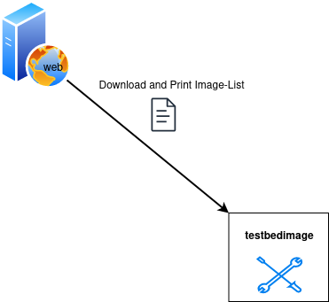

# Print Manifest

The `manifest` subcommand fetches the Manifest.json from the image-server and prints out it's content.



## Command-Line Options

```
usage: testbedimage manifest [-h] [-u URL]

options:
  -h, --help         show this help message and exit
  -u URL, --url URL  url to the images
```

`-u URL, --url URL`
: The URI to the image-server.

  Default: `https://aecidimages.ait.ac.at/current`
